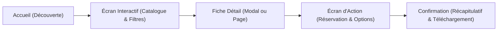

# Fiche de Cadrage — Projet Bivouac Sauvage
**Module :** TailwindCSS & SASS — ESGI Reims (Bac+3 Web)  
**Enseignant :** Cédric Navet  
**Étudiant :** Hugo Rayaume  
**Projet :** Bivouac Sauvage  
**Date :** 26 Octobre 2026  

---

## 1. Tableau de Cadrage Officiel (Étape 1)

| Rubrique | Ce qui est attendu | Détail du projet Bivouac Sauvage |
| :--- | :--- | :--- |
| **Le client** | Nom fictif, typologie, ville, taille | **Bivouac Sauvage** — Tourisme de plein air & éco-hébergements insolites. Localisé au cœur du Parc Naturel Régional de la Montagne de Reims (Verzy, 51). Domaine forestier de 15 hectares préservés, 12 hébergements éco-conçus, équipe de 4 personnes. |
| **Ce qu'il propose** | 3 à 5 services ou offres avec prix / conditions | 1. **Dôme Géodésique « La Canopée »** : dôme panoramique avec vue sur les étoiles, poêle à bois, terrasse suspendue (120 € / nuit pour 2 pers, petit-déjeuner bio inclus). 2. **Cabane des Trois Chênes** : cabane perchée à 6m accessible par passerelle en bois, poêle scandinave, bain nordique privatif (165 € / nuit jusqu'à 4 pers). 3. **Tente Bell Safari « Clairière »** : tente de glamping en coton naturel, lit queen-size en laine locale, poêle à granulés (85 € / nuit pour 2 pers). 4. **Roulotte Sylvestre Rétro** : roulotte en bois massif réhabilitée, cuisine solaire et douche extérieure abritée (95 € / nuit pour 3 pers, animaux acceptés). 5. **Pack Micro-aventure « Immersion Sauvage »** : balade naturaliste crépusculaire + panier apéritif terroir 100% bio marnais (45 € / pers en option). |
| **L'objectif du site** | Une phrase, mesurable | **« Permettre aux couples et familles en quête de déconnexion de découvrir, filtrer et réserver un hébergement insolite en pleine nature en moins de 3 minutes et avec confirmation immédiate. »** |
| **Persona 1** | Voir modèle ci-dessous, avec sa mission | **Julien (34 ans)** — Cadre parisien souhaitant un week-end romantique et ressourçant sans voiture (TER Paris-Reims + navette). |
| **Persona 2** | Profil différent (âge, contexte, appareil ou besoin) | **Corinne (58 ans)** — Retraitée active organisant un séjour nature avec ses deux petits-enfants et son chien berger australien. |
| **Les écrans** | 3 à 5 écrans, avec le rôle de chacun | 1. **Accueil** : proposition de valeur claire, immersion visuelle, engagement éco-responsable, avis clients, appel à l'action principal (réussite du test des 5 secondes). 2. **Écran interactif (Explorer & Filtrer)** : catalogue complet des 12 hébergements depuis `hebergements.json`, au moins 2 filtres combinables (capacité et type d'hébergement) + 1 filtre animaux acceptés + 1 tri (prix / note), modal de détail complet et état vide interactif avec reset. 3. **Fiche détaillée de l'hébergement** : galerie photos, descriptif complet, fiche technique, équipements, calendrier des disponibilités et tarification transparente. 4. **Écran d'action (Réservation & Devis)** : formulaire multi-étapes accessible (dates, options, voyageurs, coordonnées) avec validation en temps réel, gestion explicite des erreurs et page de confirmation avec récapitulatif téléchargeable. |
| **Les données** | Contenu du fichier JSON : type et champs | Fichier `src/data/hebergements.json` (12 hébergements réalistes). Champs : `id`, `slug`, `nom`, `type` (*dome*, *cabane*, *tente*, *roulotte*), `accroche`, `description`, `capacite` (nb personnes), `surface_m2`, `prix_par_nuit`, `note`, `nb_avis`, `animaux_acceptes` (booléen), `equipements` (tableau de strings), `eco_labels` (tableau de strings : *100% solaire*, *bain nordique*, *poêle bois*, *zéro plastique*), `image_principale`, `images_secondaires`, `disponibilites` (tableau de créneaux/statuts), `hauteur_sol_m`. |
| **Le composant en SASS** | Lequel, et pourquoi il se prête au SASS (variantes, calculs, boucle) | **`EcoBadge` & `ComfortGauge`** (CSS Module `EcoBadge.module.scss`). • Chargement de variables et mixins via `@use 'styles/theme' as *;` (aucun `@import`). • Boucle SASS `@each $category, $color in $badge-themes` pour générer automatiquement les variantes visuelles (écologie, confort, insularité, accessibilité). • Fonction de calcul mathématique et contraste SASS pour calculer automatiquement la lisibilité WCAG AA (ratio ≥ 4.5:1). • Mixins pour les animations au focus et les déclinaisons de tailles (`sm`, `md`, `lg`). |
| **L'ambiance** | Trois mots et trois couleurs | • Trois mots : **Sauvage**, **Serein**, **Éco-conçu**. • Trois couleurs principales : - **Vert Canopée** (primaire) : `#2D5A43` (décliné en 5 nuances dans `@theme`) - **Ocre Feu de Camp** (accent) : `#D97736` - **Sable Écorce** (fond neutre & texte) : Fond `#F9F8F5`, Texte écorce `#1A241E` |

---

## 2. Fiches Persona Détaillées

### Persona 1 : Julien (Usage Mobile / Déconnexion rapide)
- **Qui :** Julien, 34 ans, chef de projet digital habitant Paris, habitué aux applications mobiles modernes.
- **Contexte d'usage :** Dans le métro ou le train après une semaine de travail intense, sur son iPhone (écran 375 px, consultation à une main, réseau 4G intermittent).
- **Ce qu'il veut :** Dénicher un séjour pour 2 personnes avec lit panoramique et poêle à bois pour le week-end suivant sans devoir appeler ni remplir un devis de 10 pages.
- **Ce qui le gêne :** Les tunnels de réservation lents, les formulaires non optimisés sur mobile, les prix qui augmentent à la dernière page avec des frais cachés.
- **Sa mission mesurable :**  
  > *« Julien doit filtrer les hébergements disponibles pour 2 personnes avec vue dégagée, consulter le tarif final et valider sa réservation sur son smartphone en moins de 2 minutes et sans aucune erreur de formulaire. »*

---

### Persona 2 : Corinne (Usage Desktop / Confort, Famille & Accessibilité)
- **Qui :** Corinne, 58 ans, cadre retraitée résidant à Châlons-en-Champagne, attentive aux détails et aux avis.
- **Contexte d'usage :** Sur son ordinateur portable 14 pouces le dimanche après-midi, confortablement installée avec une souris ou un trackpad.
- **Ce qu'elle veut :** Emmener ses 2 petits-enfants (8 et 11 ans) et son chien dans un hébergement insolite mais sécurisé, de plain-pied ou facile d'accès.
- **Ce qui la gêne :** Les textes trop petits ou peu contrastés, les conditions floues concernant les animaux, les interfaces où l'on perd sa saisie en revenant en arrière.
- **Sa mission mesurable :**  
  > *« Corinne doit activer le filtre "Animaux acceptés" et "Capacité 3+", vérifier les équipements de sécurité sur la fiche détaillée et transmettre une demande de réservation avec demande d'option pour son animal en 4 étapes maximum. »*

---

## 3. Parcours Utilisateurs par Écran

1. **Julien (Mobile) :**
   - Écran 1 (Accueil) : clique directement sur le CTA héro *"Trouver un bivouac"*.
   - Écran 2 (Catalogue) : active le filtre *"2 personnes"* + tag *"Dôme"*, trie par *"Prix croissant"*.
   - Écran 3 (Détail) : ouvre la fiche du dôme « La Canopée », vérifie le poêle à bois et clique sur *"Réserver ce bivouac"*.
   - Écran 4 (Action) : choisit ses dates, entre son email/téléphone, valide en 1 clic.
   - Écran 5 (Confirmation) : voit le récapitulatif instantané avec son numéro de réservation.

2. **Corinne (Desktop) :**
   - Écran 1 (Accueil) : lit la charte éco-responsable et clique sur le menu *"Nos Éco-Hébergements"*.
   - Écran 2 (Catalogue) : coche le filtre *"Animaux acceptés"* et *"Capacité ≥ 3 personnes"*. 
   - Écran 3 (Détail) : consulte la Roulotte Sylvestre, vérifie la présence du terrain clos et du couchage pour enfants.
   - Écran 4 (Action) : sélectionne l'option *Micro-aventure famille*, renseigne les informations et envoie sa réservation avec message personnalisé.
   - Écran 5 (Confirmation) : reçoit la confirmation immédiate à l'écran avec bouton d'impression/export.
